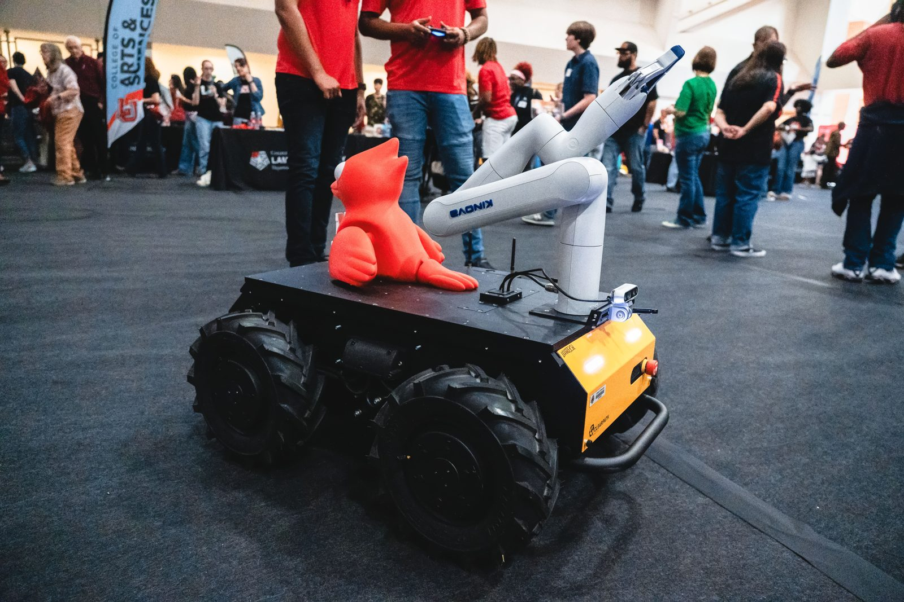
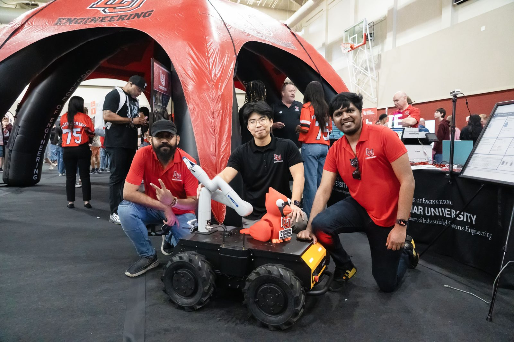
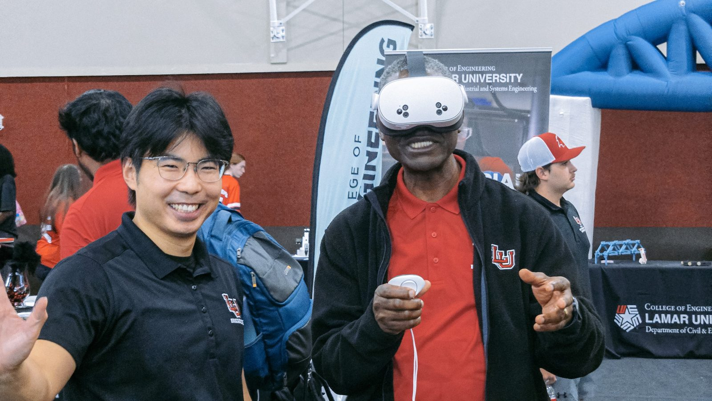
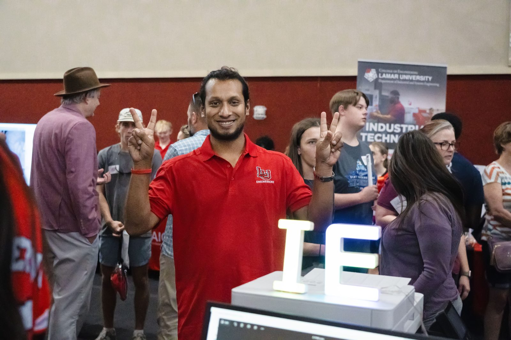
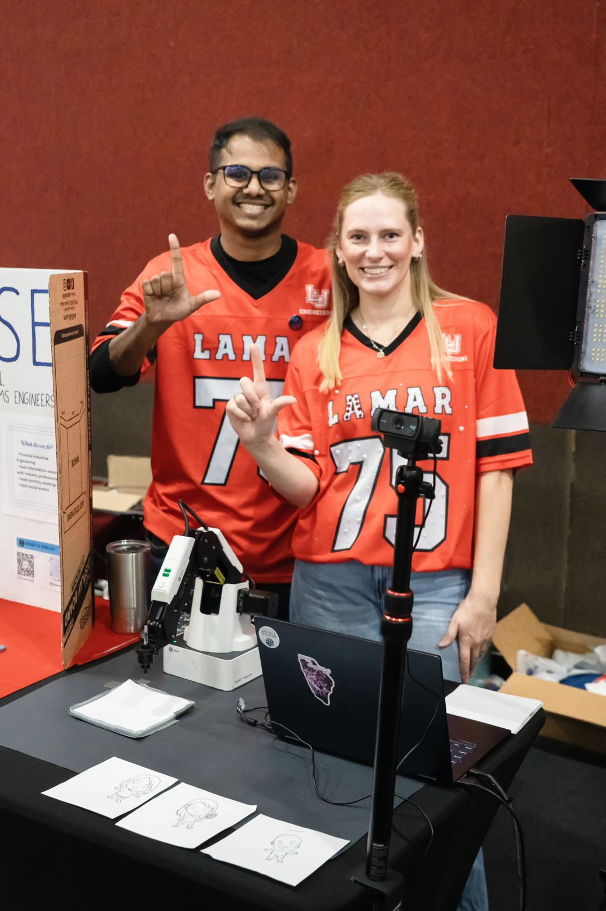
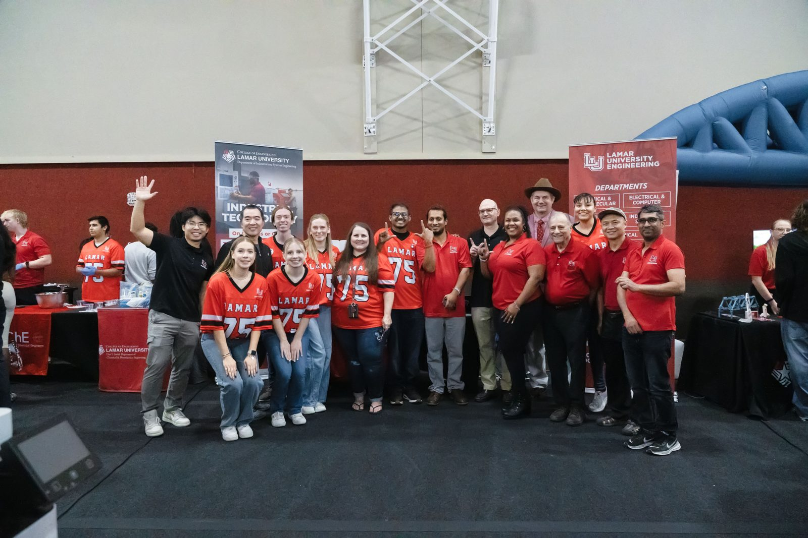

On November 7, 2026, the XRAI Lab staffed a table at the Department of
Industrial and Systems Engineering (ISE) booth at **Cardinal View**. The lab
brought a mobile manipulator, a mixed reality (MR) training system, and two
robot-arm demonstrations.

## Husky A300 with a Kinova Gen3 lite arm

The first demonstration was the lab's **Clearpath Husky A300**, an outdoor
ground vehicle, carrying a **Kinova Gen3 lite** 6-DOF arm on its top plate.
**Rohith Naini** and **Mohammad Asifur Rahman Rabby** drove the robot and
operated the arm for visitors at the booth.

Specifications and accessories for the platform are listed on the
[Lab](/lab/) page.

Pictured below with the Husky: Mohammad Asifur Rahman Rabby (left) and Rohith
Naini (right), with another lab member in the middle.

## MR hurricane responder training

The second demonstration was the lab's MR training system for hurricane
response. It runs on a Meta Quest 3s standalone and overlays augmented-reality flooding on the
real surroundings of the wearer. 

Dr. Samuel Jator, Dean of the Lamar University College of Engineering, tried
the AR flooding system at the booth unde guidance of Dr. Yang.

A demo video of the system:

<figure class="labnews-video">

<iframe src="https://www.youtube.com/embed/kQNTCcWpifg" title="AR flooding system demo" loading="lazy" allow="accelerometer; autoplay; clipboard-write; encrypted-media; gyroscope; picture-in-picture; web-share" allowfullscreen></iframe>

<figcaption>AR flooding system demo</figcaption>
</figure>

## Robot demonstrations at the ISE table

**Rafiul Azim Jowarder** showed a robot driven by a large language model (LLM)
carrying out a simple pick-and-place task.

**Arina Cunningham** showed a robot arm drawing simple line sketches, several
of which are on the table in the photo. 

## The group

The photo below shows the ISE group with the other College of Engineering
staff and students at the end of the event. 

